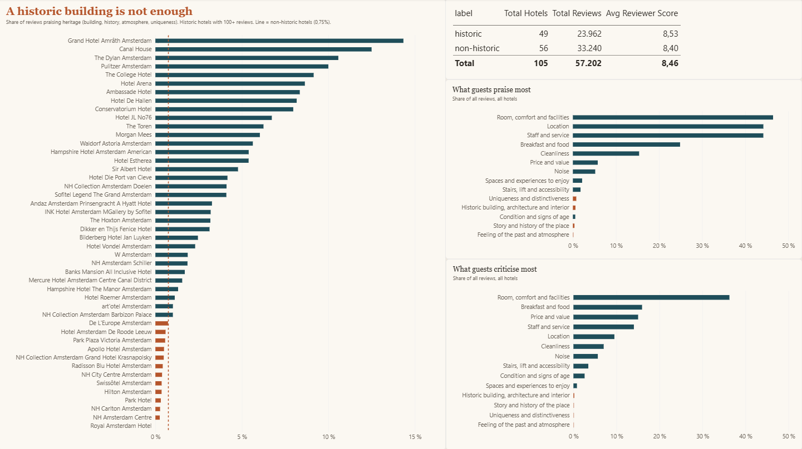
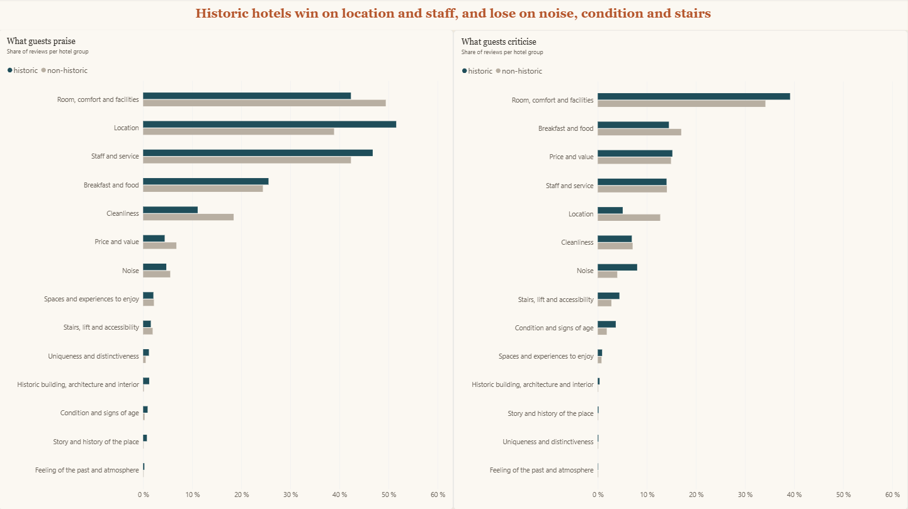
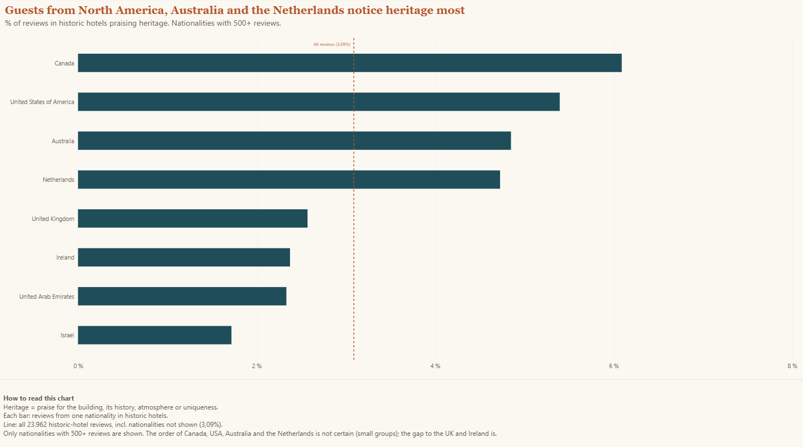

# A historic building is not enough: guest experience in Amsterdam's historic hotels

Analysis of 57,202 Booking.com reviews (August 2015 – August 2017) of 105 Amsterdam hotels, comparing
what guests praise and criticise in historic and non-historic hotels. On average, guests praise heritage
four times as often in historic hotels, but the average hides large differences: in a quarter of historic
hotels, mostly large chain hotels in listed buildings, guests mention heritage no more often than in
non-historic hotels.



---

## Key findings

1. **Guests notice heritage, and praise it far more often in historic hotels.**
   3.1% of reviews in historic hotels praise the building, its history, atmosphere or uniqueness,
   compared with 0.75% in non-historic hotels: about 4 times more (1 in 32 vs 1 in 133 reviews).
   Praise clearly outweighs criticism: 4.8 praising reviews for every critical one.

2. **But heritage is a small topic.** In both groups, guests mostly write about the room,
   location and staff (40-50% of reviews each).

3. **A historic building is not enough.** The average hides large differences between hotels.
   In 33 of 46 historic hotels (with 100+ reviews) heritage praise is above the non-historic level,
   in some far above (Amrâth 14%, Pulitzer 10%). In the other 13, mostly large chain hotels in listed
   buildings, it is no higher than in non-historic hotels.

4. **Historic hotels win on location and staff, and lose on comfort and condition.**
   They are praised more for location (51.6% vs 38.9%) and staff (46.8% vs 42.3%), and criticised
   more for noise (8.0% vs 4.0%), condition and signs of age (3.7% vs 1.8%) and stairs and lifts
   (4.4% vs 2.8%).

5. **Historic hotels score slightly higher, and not only because of their location.**
   Average review score 8.53 vs 8.40; comparing only hotels in the city centre, 8.58 vs 8.48.

6. **Guests from North America, Australia and the Netherlands notice heritage most.**
   In historic hotels, guests from Canada (6.1%), the USA (5.4%), Australia (4.9%) and the
   Netherlands (4.7%) praise heritage about twice as often as guests from the UK (2.6%) and Ireland (2.4%).

---

## Recommendations for hotel managers

- **Make the heritage visible.** A listed building alone does not create a heritage experience.
  Hotels in historic buildings, especially chain hotels, can tell the building's story in the
  interior, at check-in and online.
- **Manage the typical costs of an old building.** Noise, wear and stairs are where historic hotels
  lose. Better windows, regular maintenance and clear information about stairs and lifts before
  booking address the most common complaints.
- **Target the heritage story.** Lead with heritage in campaigns for North American, Australian and
  Dutch guests; for British and Irish guests, lead with location and service.

---

## Background

This project builds on my MA thesis *Historic hotels as experiencescapes: Tourists' co-creation of authentic travel experiences through their stay in a historic hotel* (Radboud University, 2019),
which explored through interviews how tourists experience authenticity in historic hotels. Here I test
those ideas at scale, with tens of thousands of real guest reviews.

**Research question:** What do guests praise and criticise in historic hotels compared with other
hotels in Amsterdam, and which nationalities value heritage most?

---

## Data

- **Source:** [515K Hotel Reviews Data in Europe](https://www.kaggle.com/datasets/jiashenliu/515k-hotel-reviews-data-in-europe) (Kaggle, Booking.com reviews, 2015-2017).
- **Subset:** Amsterdam only: 105 hotels, 57,202 reviews after cleaning.
- **Period:** reviews from 4 August 2015 to 3 August 2017.
- **Each review has** a positive text, a negative text, a score (1-10) and the reviewer's nationality.
- The raw data is not included in this repository because of its size.

---

## Method

**1. Labelling historic hotels.** Each of the 105 hotels was checked manually against its official
website and the Amsterdam monument register. Only the building where guests stay counts.
A hotel was labelled historic if at least one historic fact was documented:

1. **Building:** a listed monument, built in 1917 or earlier, or with a documented earlier use
   (e.g. canal house, mill, monastery, warehouse).
2. **Events or people:** a documented historic event or notable historical figure is linked to the property.
3. **Objects and interior:** original or period elements with a named period
   (e.g. 17th-century furniture, original walls or beams).
4. **Practices:** food, recipes or traditions explicitly linked to a historic period.
5. **Long history as a hotel:** operating as a hotel since 1917 or earlier
   (at least 100 years by the end of the review period, 2017).

Result: 49 historic and 56 non-historic hotels. Criteria, evidence and sources per hotel:
`docs/historic_labels_clean.xlsx`.

**2. Theme dictionary.** 14 themes (5 heritage, 9 general), based on the thesis and hotel practice,
with 287 keywords. Each theme was tested on random samples of reviews (precision 45-100%), refined,
and frozen as version 1.0 before the analysis.

**3. Analysis (SQL Server).** Each review was matched to the themes it mentions, separately in the
positive text (praise) and the negative text (criticism). Results are expressed as the share of all
reviews in each group, because the groups differ in size.

**4. Robustness checks.**
- *Core heritage:* one theme (bars, gardens, lounges) was equally common in both groups, so the
  headline uses the 4 heritage themes that are specific to historic buildings.
- *Spread across hotels:* checked that heritage praise is not driven by a few famous hotels.
- *Location:* compared scores within the city centre only, because 69% of historic but only 20%
  of non-historic hotels are central.
- *Nationalities:* only nationalities with 500+ reviews, with margins of error.

**5. Dashboard (Power BI).** Three pages: overview, historic vs non-historic, and who notices heritage.

**Tools:** SQL Server (SSMS), Excel and Power Query, Power BI.

---

## Dashboard

| Overview | Historic vs non-historic | Who notices heritage |
|---|---|---|
|  |  |  |

---

## Limitations

- **Keyword method:** keywords are in English and match words, not meaning. Precision per theme
  ranges from 45% (atmosphere) to 100% (location). Guests writing in a second language may be
  underestimated.
- **Writing is not valuing:** the analysis measures how often guests write about a topic, not how
  much it matters to them.
- **Small groups:** only 11 non-historic hotels are in the city centre; nationality results are
  limited to 500+ reviews, and the exact ranking within the top group is uncertain.
- **Hotel choice:** nationalities may choose different hotels, so part of the nationality
  difference may come from the hotels, not the guests.
- **Time:** the reviews are from 2015-2017, before COVID. Some hotels have since been renovated or
  rebranded, so the results describe that period, not today.
- **Known errors:** the keyword "canal house" also matches the hotel name Canal House (9 reviews;
  negligible effect overall). The source data removed special characters, so some names were
  restored for display.

All decisions and their reasons are documented in the decision log (`docs/`).

---

## Repository structure

```
├── README.md
├── sql/            SQL scripts in order (import, profiling, cleaning, labels, theme dictionary, analysis)
├── docs/           data dictionary, decision log, data source log, limitations, theme dictionary,
│                   analysis notes
├── data_clean/     exported lookup files (historic labels, keywords, themes)
├── powerbi/        hotel_reviews_dashboard.pbix and theme file
└── images/         dashboard screenshots
```

---

## Next steps

- **Does communicating heritage make a difference?** Code each historic hotel's website for how
  strongly it presents its heritage, and compare with heritage praise. This links back to the
  website analysis in my thesis.
- Repeat the analysis for other European cities in the same dataset (e.g. Paris, Vienna).

---

*Ana Jurić · [LinkedIn](https://www.linkedin.com/in/YOUR-PROFILE) · Data analyst with a background in tourism, culture and hospitality*